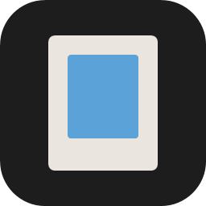

# Brand: the FrameForge mark



## The idea
**A print in a mat.**
- **The mat:** a warm-white mat (`#EAE6DF`, `Color.Mat`), the same frame FrameForge draws around a selected photo. The
  icon is the app's own gesture of picking a photo.
- **The print:** the accent blue (`#5AA2D8`), like a cyanotype.
- **The bottom border** is a little deeper than the sides and top (10 : 6 units), as framers cut them.
- **The tile:** the mark sits on a dark tile (`#1D1D1D`, `Color.Panel`, 14-unit corner radius on a 64-unit grid), so
  it reads on both light and dark taskbars.

It was chosen in M07 phase F2 over two other sketches, crop corners and a contact sheet, because it stays clear at 16 px
and matches the app's existing look (docs/ui-design-system.md). It is original, and no part of it comes from another
product.

## Where it lives
| What | File | Notes |
|---|---|---|
| **Source** | `src/FrameForge.App/Themes/Brand.xaml` | `Brand.Mark` (on its tile) and `Brand.MarkBare` (no tile, for dark surfaces). The one place the shapes are defined. Literal colours, so it loads on its own. |
| App and window icon | `src/FrameForge.App/Assets/FrameForge.ico` | 16, 20, 24, 32, 40, 48, 64 and 256 px |
| Splash | `src/FrameForge.App/Assets/Splash.png` | 720 × 300 (a 480 × 200 design drawn at 1.5×: Windows shows it pixel for pixel, without display scaling). Shown the moment the app starts, before .NET and WPF have loaded; it closes when the main window appears. |
| Documents | `docs/brand/Mark-256.png` | this page, the user guide page |

**In the app:**
- the sidebar, beside the wordmark (bare mark, 20 px)
- the About page (56 px)
- the loading state (`Views/LoadingMark`, 64 px), shown while the app starts and while the library loads

## Changing it
1. Edit the shapes in `Brand.xaml`.
2. Render the assets again:
   ```powershell
   dotnet run --project tools/FrameForge.Evaluation -c Release -- brand --xaml src/FrameForge.App/Themes/Brand.xaml --dir <new folder>
   ```
3. Copy `FrameForge.ico` and `Splash.png` into `src/FrameForge.App/Assets/`, and `Mark-256.png` into `docs/brand/`.
4. `BrandTests` checks that the source loads on its own and that the icon holds every size.

## Rules
- **Name:** use "FrameForge". The window title and About say "FrameForge AI", but the mark is never combined with "AI".
- **Colours:** only the three above. No gradients, shadows or outlines, matching the design system's restraint.
- **Size:** don't use it below 16 px, and give it at least a quarter of its size in clear space.
